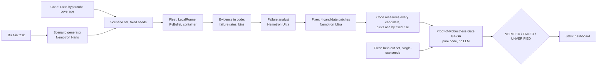

# RoboProof

[MIT License](LICENSE) · NVIDIA x Nebius Global AI Hackathon · Track: Physical AI (simulation only, no hardware)

RoboProof stress-tests a robot policy in simulation, asks NVIDIA Nemotron models to explain the failures and propose a bounded parameter fix, and only certifies the fix through a deterministic Proof-of-Robustness Gate. If the gate cannot prove the fix, the answer is FAILED or UNVERIFIED, never a quiet pass.

**This is a simulation of a simplified robot (a two-finger gripper in PyBullet), not a real robot. Nothing was validated on hardware.** One built-in task: pick a cube and place it in a target zone. Read [docs/LIMITATIONS.md](docs/LIMITATIONS.md) before trusting any number here.

**Where it ran (honest):** language-model calls used Nebius Token Factory with NVIDIA Nemotron models. Simulations ran in a local Docker container (`LocalRunner`), **not on Nebius Serverless Jobs**; the container was never tested on Nebius. Every run is labelled "local fallback, not Nebius". Cost figures are estimates (tokens x API-reported prices); actual billing is UNCONFIRMED.

## Official result (pre-registered batch, pipeline v2 frozen, LocalRunner)

Protocol: [docs/OFFICIAL_PROTOCOL.md](docs/OFFICIAL_PROTOCOL.md). 5 runs, fixed master seeds, each with its own single-use held-out block; all reported, none repeated or discarded. Full table with candidates: `recorded_runs/official_001/official_summary.md`.

| Run (master seed) | Verdict | Attempts | Held-out pass, before -> after (n=400) |
|---|---|---|---|
| official_01 (3101) | VERIFIED | 2 | 71.2% -> 96.8% |
| official_02 (3202) | VERIFIED | 2 | 68.8% -> 95.5% |
| official_03 (3303) | FAILED (G5: 348/400, needed 360) | 1 | 69.0% -> 87.0% |
| official_04 (3404) | VERIFIED | 1 | 69.2% -> 97.5% |
| official_05 (3505) | VERIFIED | 1 | 71.2% -> 96.8% |

**4 of 5 VERIFIED (small sample), Wilson 95% interval [37.6%, 96.4%].** For comparison, the v2 rehearsal study on rehearsal seeds was **4 of 8 VERIFIED** (Wilson 95% [21.5%, 78.5%]) and v1 was 1 of 5; the intervals overlap heavily, so this is not a reliability claim. Two of the four VERIFIED runs had 3 and 1 regressions on the analysis set, within the 2% budget but not zero. Measured per run: 109 to 193 s wall clock, 15k to 26k tokens, estimated cost $0.026 to $0.055 (total $0.181, estimate). All three studies are in the dashboard.

## Architecture



## Where each Nemotron model is used, and why that size

All inference goes through Nebius Token Factory (OpenAI-compatible API). Model IDs come only from env vars, never hardcoded.

| Stage | Model | Why this size |
|---|---|---|
| Scenario generator | Nemotron-3-Nano-30B-A3B (`NEBIUS_MODEL_FAST`), reasoning off. Fallback: Nemotron-3-Super-120B-A12B, then a code-only coverage set | Cheap, quick structured JSON: it proposes risky parameter regions. Code validates each region and adds the coverage sweep. |
| Failure analyst | Nemotron-3-Ultra-550B-A55B (`NEBIUS_MODEL_REASONING`) | Needs reasoning over code-computed statistics to write testable hypotheses. It never invents numbers; the dashboard looks numbers up by evidence id and marks the model's wording as unverified. |
| Fixer | Nemotron-3-Ultra | Proposes 4 bounded patches (schema-validated, clamped). Code measures all of them and selects one. |
| Gate | none | Pass/fail is decided by simulator results and deterministic code only. |

## Where Nebius is used

- **Token Factory:** every model call above, with latency and token counts logged. See [FEEDBACK.md](FEEDBACK.md) (measured notes only).
- **Serverless Jobs:** NOT used. `LocalRunner` ran every simulation. A `NebiusJobRunner` was never validated.

## Gate rules (pure code, `backend/app/gate/gate.py`)

Verdict is exactly one of VERIFIED, FAILED, UNVERIFIED. Thresholds: `backend/app/core/gate_config.py`; derivation: [docs/CEILING_SEARCH.md](docs/CEILING_SEARCH.md).

| Check | Rule |
|---|---|
| G1 determinism | 30 evenly spaced baseline scenarios re-run in fresh processes give identical results |
| G2 reproduced | every targeted failure fails again on the unpatched policy |
| G3 fixed | at least 70% of targeted failures now pass |
| G4 no regressions | previously passing analysis scenarios that now fail <= floor(2% x previously passing); the strict zero-budget result is always shown |
| G5 held-out | fresh 400-scenario code-made set, single-use seeds: patched pass rate >= 0.90, improvement >= 0.10, and patched Wilson 95% lower bound > unpatched pass rate |
| G6 complete | all shards finished, none failed or timed out |

Statuses: `pass`, `fail`, `not_run` (could not run), `skipped_after_failure` (an earlier check already failed, so the single-use held-out set is not spent). Precedence: UNVERIFIED (G6 fails or a required check is not run) > FAILED (a check that ran failed) > VERIFIED. Each path is unit-tested in `backend/tests/test_gate.py`. The thresholds were set from development data, not tuned on held-out seeds; they are judgments, see the limits page.

**Scripted trap:** a hand-written overfit patch (not model output) that fixes most targeted failures but is rejected by G4 and G5. Its stored gate result is shown in the dashboard and labelled as such.

## Setup (Windows + Docker Desktop)

The simulator needs Python 3.11 (PyBullet has no wheel for the host's 3.13), so the backend runs in a container. Git Bash is needed for `scripts/dock.sh`.

```bash
cp .env.example .env            # fill NEBIUS_API_KEY, NEBIUS_BASE_URL, model ids (never commit .env)
scripts/dock.sh build           # first build ~5 min (a cached rebuild took 43 s)
scripts/dock.sh python scripts/list_models.py   # lists models for your key; fill NEBIUS_MODEL_* in .env
scripts/dock.sh test            # test suite inside the image
```

## Run the pipeline

A live run on rehearsal seeds (not held-out, so it can be repeated; it does spend Token Factory credits, about $0.03 estimated). Set `LLM_DEV_CACHE=0` in `.env`.

```bash
scripts/dock.sh python scripts/run_reliability.py --seeds 701 --out recorded_runs/my_run
```

It prints `MODE: REHEARSAL` and takes about 3.5 minutes (one measured run: 3m45s, $0.031 estimated). Artifacts land in `recorded_runs/my_run/run_01_seed701/` (including `gate_report.json`) with a `summary.md`. Official runs (`scripts/run_official.py`) refuse to start unless the tree is clean and the frozen pipeline hash matches tag `pipeline-frozen-v2`; they spend single-use held-out seeds and are not meant to be re-run.

## Dashboard and design

The site (`frontend/`: React, TypeScript, Vite, Tailwind, framer-motion, three.js via react-three-fiber) works on its own as a static site: it reads exported JSON from recorded real runs, and nothing on it is computed live unless the optional live backend is running.

```bash
scripts/dock.sh python scripts/export_demo_data.py   # optional: regenerate frontend/public/data from recorded_runs (keeps live_replay/)
cd frontend
npm install
npm run dev                          # http://localhost:5173
npm run build && npm run preview     # production build from frontend/dist
```

Routes: `/` landing, `/playground`, `/results` official batch, studies, the 3D failure map and a live panel listing runs created on this server (`GET /api/runs`; "backend offline" when there is none), `/runs` and `/runs/:id` run detail, `/live` live console, `/live/report/:id`, `/trap` (scripted example), `/about` (limits). Fonts are self-hosted (`@fontsource`). The hero scene is a procedural, purely illustrative animation (captioned as such); the failure map plots real scenarios from the recorded runs (the unpatched policy on each run's analysis set; per-scenario patched results were not stored, so none are shown). The 3D code is in lazy chunks, and a footer toggle ("Reduce motion and 3D", also set by `prefers-reduced-motion`) replaces it with static content. Nothing on the site is invented: counters come from the data, and the honesty labels (local runner, rehearsal vs official, unverified model opinion, scripted example) are kept on every page.

## Running live

A live run executes the real pipeline (`scripts/run_reliability.py` with one server-chosen rehearsal seed) as a subprocess of a small FastAPI service in the sim image. It is always a **rehearsal**: it can never be official, never uses held-out seeds (900000 and up), and the browser can send nothing but an access code. It makes real Nebius Token Factory calls, so it spends credits (about $0.03 estimated per run; billing is not checked).

```bash
cp .env.example .env          # fill the NEBIUS_* values, then set LIVE_ENABLED=1 (live runs are OFF by default)
docker compose up --build     # API on http://localhost:8000 (API_PORT=8010 docker compose up if 8000 is taken)
cd frontend && VITE_API_BASE=http://localhost:8000 npm run build   # point the site at the API (also set ALLOWED_ORIGINS in .env to the site's origin)
```

Endpoints: `GET /api/health`, `GET /api/live/status`, `POST /api/runs`, `GET /api/runs/{id}`, `GET /api/runs/{id}/events` (server-sent events, replayable from the start), `POST /api/runs/{id}/cancel`, plus `/report`, `/scenarios` and whitelisted `/files/{name}`. Protections: one run at a time, per-IP rate limit, daily run cap (`LIVE_DAILY_RUN_CAP`) and daily estimated-spend cap (`LIVE_DAILY_USD_CAP`), optional `LIVE_ACCESS_CODE`, kill switch `LIVE_ENABLED`, CORS allowlist `ALLOWED_ORIGINS` (never `*`), a 10-minute timeout, cancel, secret scrubbing of every event and log. Progress events come from the subprocess output, artifact files as the pipeline writes them, and the pipeline's own LLM-call log; the pipeline writes candidate tables and gate results together at the end, so those appear together. Tests (`backend/tests/test_live.py`) use a fake pipeline and make no real calls.

**Static hosting:** a static host has no backend, so `/live` shows "Live runs are offline in this deployment" and offers **Replay a recorded live run**: the event stream and report of one real live run through the API (2026-10-23: VERIFIED, 153.5 s, about $0.031 estimated), clearly labelled as a recorded replay. The live backend needs a host that can run a container (the sim image) with the `.env` secrets.

## Playground

`/playground` lets you enter your own scenario conditions (cube mass, friction, size, position offsets, sensor noise, gripper delay) and policy parameters, and get **real results from the frozen simulator**. Controls are built from `GET /api/sim/spec`, which reads the frozen bounds and defaults; the two parameters measured to have no effect are shown greyed out.

- **Single scenario** (`POST /api/sim/scenario`): success, collision, completion time, place error, slip, a plain-language failure reason, and a 3D playback of the real recorded trajectory (at most 300 frames).
- **Sweep** (`POST /api/sim/sweep`, up to 200 scenarios): a seeded Latin-hypercube sweep of your policy and, on the identical scenarios, the default policy (cached): pass rates with Wilson 95% intervals, failure reasons, per-axis failure rates (from the evidence code), and the 3D failure map. Clicking a point replays that scenario exactly.
- **Plain-English input** (`POST /api/sim/interpret`, optional): describe a situation in up to 300 characters ("A 700 g cube on a wet tray with a noisy camera"). The fast Nemotron model (thinking off, second Nemotron model as fallback) proposes the seven scenario values and a one-line reason each, as strict JSON validated against the frozen bounds (values up to 10% of the range outside are clamped and flagged, further out are rejected). Descriptions that are not about the cube task (a drone, a humanoid) come back as "unsupported". It only proposes: it never runs the simulation, the user edits and presses Run, and the result is labelled "model interpretation, unverified". The user's text is data (length-limited, delimited, after the instructions, with an instruction to ignore instructions inside it); only the schema output is used, the API key is never in a prompt, and model-written text is sanitised. It needs `LIVE_ENABLED=1`, the access code if set, a per-IP rate limit (`PLAYGROUND_RATE_INTERPRET_PER_HOUR`) and room under the daily spend cap; a call costs about $0.0001 (estimate).
- **CSV or pasted batch** (`POST /api/sim/batch`, Sweep tab, "Upload CSV or paste rows"): a table with a header row and exactly the seven scenario columns (a template is generated from the spec: `GET /api/sim/batch/template`), at most 200 rows and 100 KB. Every row is validated against the frozen bounds and problems come back per row and field; nothing runs if any row is invalid. Seeds are assigned by row (700000 + row index, deterministic, never held-out). The rows run with your policy and with the default policy; you get a per-row results table, pass rates with Wilson intervals, the comparison, the 3D failure map (click a row or point to replay it) and a results CSV whose text cells are neutralised against spreadsheet formula injection. No model is involved. A sample file is in `docs/demo_scenarios.csv`.
- **Analyze with Nemotron** (`POST /api/sim/analyze`, optional): grounded hypotheses for a finished sweep, labelled "model opinion, unverified". It spends credits, so it needs `LIVE_ENABLED=1`, the access code if set, room under the daily spend cap, and a confirmation; it is never automatic.

Safety: no LLM spend for scenario and sweep; every field validated against the frozen bounds (out-of-range, NaN and infinity rejected, unknown fields rejected); playground seeds are 100000 to 799999 only (held-out and rehearsal seeds are refused); per-IP rate limits, at most 2 simulations at once, 20 s and 60 s timeouts (the simulation runs in a killable process), `PLAYGROUND_ENABLED` kill switch. Results are **exploration, not a gate verdict** and are never part of the official evaluation.

**What it cannot do:** the simulator models one task (a gripper picks a cube and places it in a target zone). A different robot would need a new simulator and a recalibrated gate; that is future work. On a static host with no backend, the page shows three recorded real simulator runs, labelled as recorded examples.

## Tests

`scripts/dock.sh test` (full suite incl. simulator and the live-service tests). On the host, `cd backend && python -m pytest -q` runs the non-simulator tests and skips the rest.

## Layout and further docs

`backend/app/{api,core,llm,sim,scenarios,runner,analysis,gate,store}`, `frontend/`, `scripts/`, `docker/`, `docs/`, `recorded_runs/`. Simulator limits: [docs/SIM_FIDELITY.md](docs/SIM_FIDELITY.md). Pipeline v1 vs v2 diagnosis: [docs/P46_DIAGNOSIS.md](docs/P46_DIAGNOSIS.md). Scope: [CLAUDE.md](CLAUDE.md), [PROJECT_BRIEF.md](PROJECT_BRIEF.md). Progress: [STATUS.md](STATUS.md).

## License

MIT, see [LICENSE](LICENSE).
