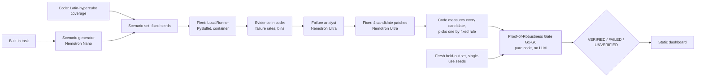

# RoboProof

[MIT License](LICENSE) · NVIDIA x Nebius Global AI Hackathon · Track: Physical AI (simulation only, no hardware)

RoboProof stress-tests a robot policy in simulation, asks NVIDIA Nemotron models to explain the failures and propose a bounded parameter fix, and only certifies the fix through a deterministic Proof-of-Robustness Gate. If the gate cannot prove the fix, the answer is FAILED or UNVERIFIED, never a quiet pass.

**This is a simulation of a simplified robot (a two-finger gripper in PyBullet), not a real robot. Nothing was validated on hardware.** One built-in task: pick a cube and place it in a target zone. Read [docs/LIMITATIONS.md](docs/LIMITATIONS.md) before trusting any number here.

**Where it ran (honest):** language-model calls used Nebius Token Factory with NVIDIA Nemotron models. Simulations ran in a local Docker container (`LocalRunner`), **not on Nebius Serverless Jobs**; the container was never tested on Nebius. Every run is labelled "local fallback, not Nebius". Cost figures are estimates (tokens x API-reported prices); actual billing is UNCONFIRMED.

## Official result (pre-registered batch, pipeline v2 frozen, LocalRunner)

Protocol: [docs/OFFICIAL_PROTOCOL.md](docs/OFFICIAL_PROTOCOL.md). 5 runs, fixed master seeds, each with its own single-use held-out block; all reported, none repeated or discarded. Full table with candidates: `recorded_runs/official_001/official_summary.md`.

| Run (master seed) | Verdict | Attempts | Held-out pass, before -> after (n=400) |
|---|---|---|---|
| official_01 (3101) | VERIFIED | 2 | 71.2% -> 96.8% |
| official_02 (3202) | VERIFIED | 2 | 68.8% -> 95.5% |
| official_03 (3303) | FAILED (G5: 348/400, needed 360) | 1 | 69.0% -> 87.0% |
| official_04 (3404) | VERIFIED | 1 | 69.2% -> 97.5% |
| official_05 (3505) | VERIFIED | 1 | 71.2% -> 96.8% |

**4 of 5 VERIFIED (small sample), Wilson 95% interval [37.6%, 96.4%].** For comparison, the v2 rehearsal study on rehearsal seeds was **4 of 8 VERIFIED** (Wilson 95% [21.5%, 78.5%]) and v1 was 1 of 5; the intervals overlap heavily, so this is not a reliability claim. Two of the four VERIFIED runs had 3 and 1 regressions on the analysis set, within the 2% budget but not zero. Measured per run: 109 to 193 s wall clock, 15k to 26k tokens, estimated cost $0.026 to $0.055 (total $0.181, estimate). All three studies are in the dashboard.

## Architecture



## Where each Nemotron model is used, and why that size

All inference goes through Nebius Token Factory (OpenAI-compatible API). Model IDs come only from env vars, never hardcoded.

| Stage | Model | Why this size |
|---|---|---|
| Scenario generator | Nemotron-3-Nano-30B-A3B (`NEBIUS_MODEL_FAST`), reasoning off. Fallback: Nemotron-3-Super-120B-A12B, then a code-only coverage set | Cheap, quick structured JSON: it proposes risky parameter regions. Code validates each region and adds the coverage sweep. |
| Failure analyst | Nemotron-3-Ultra-550B-A55B (`NEBIUS_MODEL_REASONING`) | Needs reasoning over code-computed statistics to write testable hypotheses. It never invents numbers; the dashboard looks numbers up by evidence id and marks the model's wording as unverified. |
| Fixer | Nemotron-3-Ultra | Proposes 4 bounded patches (schema-validated, clamped). Code measures all of them and selects one. |
| Gate | none | Pass/fail is decided by simulator results and deterministic code only. |

## Where Nebius is used

- **Token Factory:** every model call above, with latency and token counts logged. See [FEEDBACK.md](FEEDBACK.md) (measured notes only).
- **Serverless Jobs:** NOT used. `LocalRunner` ran every simulation. A `NebiusJobRunner` was never validated.

## Gate rules (pure code, `backend/app/gate/gate.py`)

Verdict is exactly one of VERIFIED, FAILED, UNVERIFIED. Thresholds: `backend/app/core/gate_config.py`; derivation: [docs/CEILING_SEARCH.md](docs/CEILING_SEARCH.md).

| Check | Rule |
|---|---|
| G1 determinism | 30 evenly spaced baseline scenarios re-run in fresh processes give identical results |
| G2 reproduced | every targeted failure fails again on the unpatched policy |
| G3 fixed | at least 70% of targeted failures now pass |
| G4 no regressions | previously passing analysis scenarios that now fail <= floor(2% x previously passing); the strict zero-budget result is always shown |
| G5 held-out | fresh 400-scenario code-made set, single-use seeds: patched pass rate >= 0.90, improvement >= 0.10, and patched Wilson 95% lower bound > unpatched pass rate |
| G6 complete | all shards finished, none failed or timed out |

Statuses: `pass`, `fail`, `not_run` (could not run), `skipped_after_failure` (an earlier check already failed, so the single-use held-out set is not spent). Precedence: UNVERIFIED (G6 fails or a required check is not run) > FAILED (a check that ran failed) > VERIFIED. Each path is unit-tested in `backend/tests/test_gate.py`. The thresholds were set from development data, not tuned on held-out seeds; they are judgments, see the limits page.

**Scripted trap:** a hand-written overfit patch (not model output) that fixes most targeted failures but is rejected by G4 and G5. Its stored gate result is shown in the dashboard and labelled as such.

## Setup (Windows + Docker Desktop)

The simulator needs Python 3.11 (PyBullet has no wheel for the host's 3.13), so the backend runs in a container. Git Bash is needed for `scripts/dock.sh`.

```bash
cp .env.example .env            # fill NEBIUS_API_KEY, NEBIUS_BASE_URL, model ids (never commit .env)
python scripts/list_models.py   # (needs the openai package) lists models for your key; fill NEBIUS_MODEL_* in .env
scripts/dock.sh build           # first build ~5 min
scripts/dock.sh test            # test suite inside the image
```

## Run the pipeline

A live run on rehearsal seeds (not held-out, so it can be repeated; it does spend Token Factory credits, about $0.03 estimated). Set `LLM_DEV_CACHE=0` in `.env`.

```bash
scripts/dock.sh python scripts/run_reliability.py --seeds 701 --out recorded_runs/my_run
```

It prints `MODE: REHEARSAL` and takes about 3.5 minutes (one measured run: 3m45s, $0.031 estimated). Artifacts land in `recorded_runs/my_run/run_01_seed701/` (including `gate_report.json`) with a `summary.md`. Official runs (`scripts/run_official.py`) refuse to start unless the tree is clean and the frozen pipeline hash matches tag `pipeline-frozen-v2`; they spend single-use held-out seeds and are not meant to be re-run.

## Dashboard (static, no backend)

It reads only exported JSON from recorded real runs. Nothing is computed live and no model is called.

```bash
python scripts/export_demo_data.py   # regenerate frontend/public/data from recorded_runs (run in the sim image: scripts/dock.sh python scripts/export_demo_data.py)
cd frontend
npm install
npm run dev                          # http://localhost:5173
npm run build && npm run preview     # production build from frontend/dist
```

Pages: Overview (official batch), Run detail (gate checklist, candidates, hypotheses, heatmaps, same-seed replay), Scripted trap, Limits. `DEMO_MODE` is simply this: the site is the recorded real runs.

## Tests

`scripts/dock.sh test` (full suite incl. simulator). On the host, `cd backend && python -m pytest -q` runs the non-simulator tests and skips the rest.

## Layout and further docs

`backend/app/{api,core,llm,sim,scenarios,runner,analysis,gate,store}`, `frontend/`, `scripts/`, `docker/`, `docs/`, `recorded_runs/`. Simulator limits: [docs/SIM_FIDELITY.md](docs/SIM_FIDELITY.md). Pipeline v1 vs v2 diagnosis: [docs/P46_DIAGNOSIS.md](docs/P46_DIAGNOSIS.md). Scope: [CLAUDE.md](CLAUDE.md), [PROJECT_BRIEF.md](PROJECT_BRIEF.md). Progress: [STATUS.md](STATUS.md).

## License

MIT, see [LICENSE](LICENSE).
